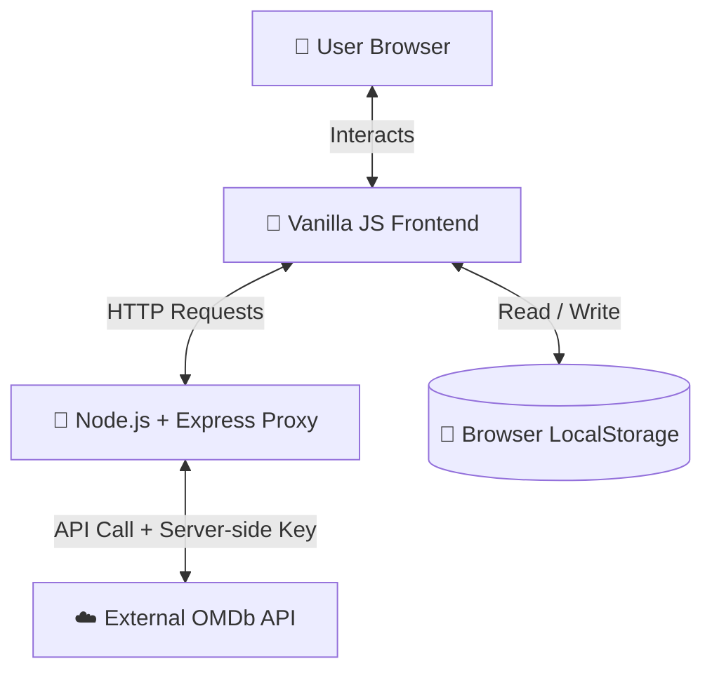

<div align="center">

# CineScope
[](https://developer.mozilla.org/en-US/docs/Web/JavaScript)
[](https://developer.mozilla.org/en-US/docs/Web/HTML)
[](https://developer.mozilla.org/en-US/docs/Web/CSS)
[](https://nodejs.org/)
[](https://expressjs.com/)
[](https://www.omdbapi.com/)
[](https://www.netlify.com/)
[](https://render.com/)

  <h3>🔗 <a href="https://cinescope-worldofmovies.netlify.app/">CineScope - Your Lens Into the World of Movies</a></h3>
  <p>
    <i>A lightweight, full-stack movie discovery platform where users can search movies, explore details, submit ratings & reviews, and keep a personal watchlist, with the OMDb API key held server-side behind an Express proxy.</i>
  </p>

  <h3><a href="https://youtu.be/YoLwDTEHoXk"></a></h3>
  <p>
    The demo video walks through movie search, the details modal, rating and review submission, the persistent watchlist, and the Express API proxy.
  </p>
</div>

---

## 📌 Project Overview
Movie enthusiasts who just want to browse films, leave a review, and track a watchlist are often pushed toward bloated platforms that require an account before any meaningful interaction. Calling a third-party API directly from the browser also exposes the private API key in network traffic, and heavy frontend frameworks add overhead to what is a single-purpose utility.

**CineScope** is a lightweight, clutter-free alternative. It needs no signup and no database: a vanilla JavaScript frontend talks to a small Express proxy that calls the OMDb API with the key kept server-side, and personal data (watchlist and reviews) lives in the browser's `localStorage`.

---

## 📊 At a Glance
| Metric | Count |
| :--- | :--- |
| User-facing features | **8** |
| Client-side validation and verification checks | **6** |
| Error-recovery mechanisms | **3** |
| Production-critical issues resolved | **5** |
| OMDb API keys in frontend code or browser network requests | **0** |

---

## ✨ Features
| # | Feature | Description |
| :-: | :--- | :--- |
| 1 | **🔎 Movie Search** | Search by title with the Search button or the Enter key. |
| 2 | **🎞️ Results Grid** | Matching movies render dynamically as cards in a CSS Grid, with no page reload. |
| 3 | **📖 Details Modal** | View poster, genre, director, cast, and full plot in a single-page modal. |
| 4 | **📌 Add to Watchlist** | Save a movie to your watchlist from its details modal. |
| 5 | **🗂️ Personal Watchlist** | A dedicated section that shows your saved movies and loads on page start. |
| 6 | **⭐ Rating (1–5)** | Submit a numeric rating for any movie. |
| 7 | **📝 Text Reviews** | Write a review and see all reviews for that movie in the modal. |
| 8 | **❌ Modal Dismissal** | Close the modal with the close button or by clicking the backdrop. |

### Supporting Architecture (not counted as features)
* **Express proxy** that keeps the OMDb API key off the client.
* **`localStorage` persistence** for the watchlist and reviews, so no database is needed.
* **Responsive grid layout** that reflows movie cards using `auto-fit` columns.

---

## 🏗️ Architecture
CineScope separates a static frontend from a small backend proxy so the API key never reaches the browser.

### System Flow


### Request Lifecycle
1. **Search input:** pressing Enter or clicking Search triggers `fetchMovies()` once the trimmed query is non-empty, which sends a `GET` to the proxy's `/search` endpoint.
2. **Proxy search route:** `/search` reads `req.query.q`, builds the OMDb URL with the server-side `OMDB_KEY`, and returns OMDb's JSON response unmodified.
3. **Card rendering:** `displayMovies()` iterates the `Search` array and injects movie cards into the grid.
4. **Details modal:** clicking a card calls `openMovieDetails(imdbID)`, which fetches `/details/:id` (OMDb full-plot endpoint) and fills the modal.
5. **Persistence:** watchlist additions and reviews are serialized to `localStorage` under fixed keys. The watchlist loads on page start and reviews load when a movie's modal opens.

### Key Engineering Decisions
1. **Express proxy:** the OMDb key lives only in a server-side environment variable. Direct browser-to-OMDb calls would expose it in the network tab.
2. **`localStorage` over a database:** watchlist and review data are personal and low-volume, so this removes the need for a database, authentication, and sessions. *Trade-off:* data is browser-local and not portable across devices.
3. **Vanilla JS over a framework:** the interactions (search, modal, watchlist, reviews) are straightforward DOM work. There is no build step, and the frontend deploys as plain static files.
4. **Dynamic handler binding on the modal:** `reviewForm.onsubmit` and `addToWatchlistBtn.onclick` are reassigned each time a modal opens, so the handlers close over the current movie. This avoids a global "selected movie" variable and keeps handler logic tied to the modal lifecycle.

---

## 🛠️ Tech Stack
| Category | Technologies |
| :--- | :--- |
| **Frontend** | HTML5, CSS3 (Grid, Flexbox, custom red, black, and cream theme), Vanilla JavaScript (ES6+) |
| **Backend** | Node.js, Express.js, CORS, Dotenv, Node-Fetch |
| **API** | OMDb REST API |
| **Persistence** | Browser `localStorage` API |
| **Deployment** | Render (Backend), Netlify (Frontend) |
| **Testing** | Manual, in the browser and with direct HTTP requests (no automated test suite) |

---

## 📂 Project Structure
```text
cinescope/
├── backend/
│   ├── .env                 # Environment variables (Git-ignored)
│   ├── package.json         # Backend dependencies & run scripts
│   └── server.js            # Express server & OMDb API proxy endpoints
├── frontend/
│   ├── index.html           # Main markup structure & modal layout
│   ├── style.css            # Layout, grid, modal, and theme styles
│   └── script.js            # DOM operations, API calls, and localStorage state
├── assets/                  # Demo screenshots used in this README
├── README.md                # Project documentation
└── .gitignore               # Excludes node_modules, env secrets, and lockfile
```

### Major File Descriptions
* **[server.js](backend/server.js)**: Runs the Express server, injects `OMDB_KEY` server-side, enables CORS, and exposes `/search` and `/details/:id`.
* **[index.html](frontend/index.html)**: The single-page shell with the search bar, results and watchlist grids, and the details modal.
* **[script.js](frontend/script.js)**: Handles backend fetches, card rendering, modal handlers, and `localStorage` reads and writes.
* **[style.css](frontend/style.css)**: Grid layout, modal, hover transitions, and the dark red, black, and cream palette.

---

## 🔌 API Integration & Security
CineScope talks to the external **OMDb API** through a small backend proxy.

### Endpoint Mapping
1. **Search:** `/search?q={query}`
   * Maps to `https://www.omdbapi.com/?apikey=${OMDB_KEY}&s={query}`
   * Returns a list of matching movies.
2. **Details:** `/details/:id`
   * Maps to `https://www.omdbapi.com/?apikey=${OMDB_KEY}&i={id}&plot=full`
   * Returns full metadata for one IMDb ID.

### What the Proxy Does
* The client calls the proxy (for example `https://cinescope-7k1y.onrender.com/search?q=Batman`).
* The proxy reads `process.env.OMDB_KEY`, builds the OMDb request, and returns OMDb's JSON to the client unmodified.
* The OMDb key never appears in the frontend code or in the browser's network requests.

### Security Notes
The proxy **hides the API key; it is not a full security layer.**
* CORS is enabled with `app.use(cors())`, which allows all origins (no origin whitelist yet).
* There is no rate limiting or quota protection, and no server-side input validation.
* Movie and review text are rendered with `innerHTML`; switching to `textContent` or sanitizing the values is a planned improvement.
* The OMDb key was accidentally committed once in `backend/.env`. The file was removed from tracking and ignored, and **the key has since been rotated**, so the value in Git history is no longer valid.

---

## ✅ Validation & Error Recovery
### 6 Client-Side Validation and Verification Checks
1. Search query is trimmed and must be non-empty.
2. The OMDb response must contain a `Search` array before results are rendered.
3. OMDb's `"N/A"` poster value is detected and routed to a fallback image path.
4. Duplicate watchlist entries are blocked by IMDb ID.
5. Rating is required and constrained to 1–5 (HTML5 form constraints).
6. Review text is required (HTML5 form constraints).

> These checks run in the browser only. A direct HTTP request to the backend bypasses all six.

### 3 Error-Recovery Mechanisms
1. **Client fallback:** `fetchMovies()` uses `try/catch` and shows "Error loading movies." if the request fails or the response is not valid JSON (for example, when the backend is unreachable or cold-starting).
2. **Backend handling:** both proxy routes use `try/catch` and return an HTTP 500 JSON error if the OMDb call throws, so the Node process keeps running.
3. **Null-safe storage reads:** `JSON.parse(localStorage.getItem(KEY)) || []` (or `{}`) gives first-time visitors an empty default.

---

## 💡 Implementation Highlights
### 1. API Proxy Routing
The Node.js proxy keeps the key server-side and returns OMDb's response to the browser:
```javascript
app.get("/search", async (req, res) => {
  const query = req.query.q;
  try {
    const response = await fetch(`https://www.omdbapi.com/?apikey=${process.env.OMDB_KEY}&s=${query}`);
    const data = await response.json();
    res.json(data);
  } catch (err) {
    res.status(500).json({ error: "Error fetching data" });
  }
});
```

### 2. Client-Side State Synchronization
Instead of a state library, `localStorage` is read and written directly on each interaction, with duplicate prevention by IMDb ID:
```javascript
function addToWatchlist(movie) {
  let watchlist = JSON.parse(localStorage.getItem(WATCHLIST_KEY)) || [];
  if (!watchlist.find((m) => m.imdbID === movie.imdbID)) {
    watchlist.push(movie);
    localStorage.setItem(WATCHLIST_KEY, JSON.stringify(watchlist));
    loadWatchlist();
  }
}
```

### 3. Per-Movie Modal Handlers
Handlers are rebound each time the modal opens so they close over the current movie's ID:
```javascript
reviewForm.onsubmit = (e) => {
  e.preventDefault();
  const rating = document.getElementById("rating").value;
  const reviewText = document.getElementById("reviewText").value;
  saveReview(id, rating, reviewText);
  loadReviews(id);
  reviewForm.reset();
};
```

---

## 🚀 Deployment
The app is deployed with a decoupled frontend and backend:
* **Frontend**: [Netlify](https://www.netlify.com/) at [cinescope-frontend](https://cinescope-worldofmovies.netlify.app/)
* **Backend**: [Render](https://render.com/) at [cinescope-backend](https://cinescope-7k1y.onrender.com)

The backend binds to `process.env.PORT || 3000`, since Render assigns the port.

---

## 💻 Local Development Setup

### Prerequisites
* **Node.js** (v16.0.0 or higher recommended)
* **npm** (comes with Node.js)
* **OMDb API Key** (free or developer key from [omdbapi.com](https://www.omdbapi.com/))

### Installation & Run Steps
1. **Clone the Repository:**
   ```bash
   git clone https://github.com/Shafia-01/CineScope.git
   cd CineScope
   ```

2. **Configure & Run Backend Server:**
   ```bash
   cd backend
   npm install
   ```
   Create a `.env` file in the `backend/` directory (never commit it):
   ```env
   PORT=3000
   OMDB_KEY=your_omdb_api_key_here
   ```
   Start the server:
   ```bash
   npm start
   # or: node server.js
   ```
   Verify it is running at `http://localhost:3000/search?q=Interstellar`

3. **Configure & Run Frontend Client:**
   * Go to the `frontend/` directory.
   * Point the base API URL at the top of `script.js` to your local server:
     ```javascript
     const API_BASE = "http://localhost:3000";
     ```
   * Open `frontend/index.html` in your browser (double-click it or use VS Code Live Server at `http://127.0.0.1:5500`).

---

## 📸 Screenshots

<h3 align="center">1. Search & Watchlist Experience</h3>
<p align="center"><i>The home page lets users search for movies, view results, and manage a personal watchlist.</i></p>
<p align="center">
  
  
  
</p>

<br>

<h3 align="center">2. Movie Details & Reviews</h3>
<p align="center"><i>The details modal shows movie metadata from OMDb, alongside ratings and reviews that persist locally.</i></p>
<p align="center">
  
  
</p>

---

## 🛡️ Challenges & Learnings
Five production-critical issues were resolved to get CineScope deployed:

1. **API key exposure:** the first version called OMDb directly from the browser, which would have exposed the key. Moving the call behind the Express proxy keeps the key in a server-side environment variable.
2. **CORS:** with the frontend and backend on separate origins, the browser blocked requests. Enabling the `cors` middleware fixed it (currently allowing all origins).
3. **Committed `.env`:** `backend/.env` was committed by mistake. It was removed from tracking and added to `.gitignore`, and the OMDb key was rotated because the old value remains in Git history.
4. **Endpoint alignment (the hardest bug):** the frontend called the Render URL without the `/api` prefix the backend still used, which returned HTTP 404s. Setting the base URL to the Render backend and registering the routes as `/search` and `/details/:id` fixed it.
5. **Dynamic port binding:** the port was hardcoded to 3000, but Render assigns one. The backend now uses `process.env.PORT || 3000`.

### Lessons Learned
* **Per-open handler binding:** binding `onsubmit` and `onclick` on each modal open, not once at startup, is necessary when handlers must close over per-movie state like the IMDb ID.
* **`localStorage` limits:** it is enough for single-device personal state but becomes the first bottleneck once cross-device sync or multiple users are needed, so the data schema should be designed with that migration in mind.
* **"N/A" data:** many OMDb entries lack posters or plot details, so the UI checks for `"N/A"` values instead of assuming data exists.

---

## ⚠️ Known Limitations
* The proxy has no server-side validation, rate limiting, caching, or origin whitelist.
* The search query is not URL-encoded before being sent.
* The client does not check `res.ok`, so an HTTP 500 from the proxy shows "No results found."
* Corrupted JSON in `localStorage` is not handled.
* The `required` attribute accepts a whitespace-only review.
* There are no retries and no automated tests.

---

## 🚀 Future Roadmap
* **🧱 Server-Side Hardening:** add server-side validation (for example with `express-validator`), an origin whitelist, rate limiting, and URL-encoding for the search query.
* **⚡ Response Caching:** add in-memory or Redis caching on the proxy to reduce repeated OMDb calls for common searches and detail lookups.
* **🛡️ Safer Rendering & Error Handling:** use `textContent` (or sanitize) instead of `innerHTML`, check `res.ok` on the client, and add the missing placeholder image.
* **🔑 User Authentication:** add JWT-based authentication for personalized logins and private profiles.
* **☁️ Database Integration:** replace `localStorage` with a cloud database (for example MongoDB or PostgreSQL) for cross-device sync.
* **🎯 Recommendation Engine:** add content-based recommendations from user ratings and genres.
* **📢 Social Sharing:** let users share their watchlist or reviews through unique URLs.